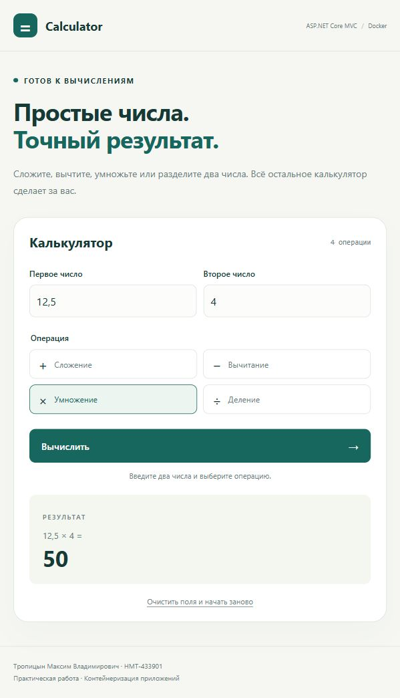
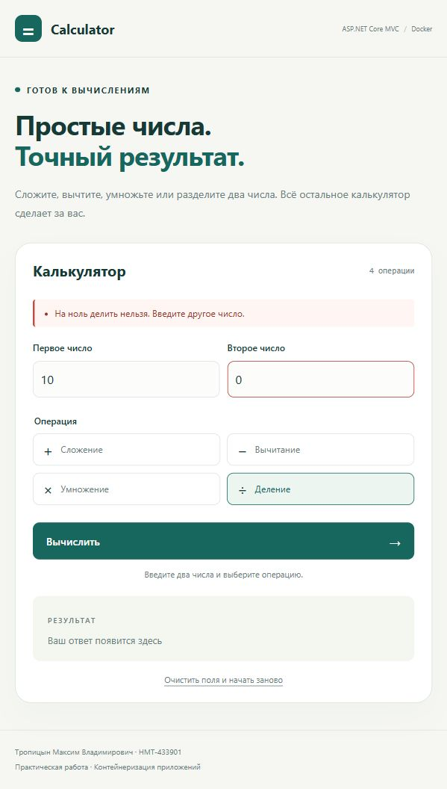

Уральский федеральный университет
имени первого Президента России Б. Н. Ельцина

Отчет по практической работе
Контейнеризация приложения
Калькулятор с использованием Docker

ASP.NET Core MVC
Задание 1.7.1

Выполнил Тропицын Максим Владимирович
Группа НМТ-433901
Номер в журнале 16
Преподаватель Лавров В. В.

Екатеринбург 2026
Дата подготовки 13 октября 2026 года

## 1 Цель работы и состояние выполнения

Цель работы - разработать веб-калькулятор на ASP.NET Core MVC, подготовить Dockerfile, разместить исходный код на GitHub и проверить сборку, запуск, остановку и повторный запуск контейнера.

Приложение дополнено MariaDB: после каждого успешного расчета сохраняются два операнда, операция и результат. Образ 16-calculator:latest собран, приложение и MariaDB запущены через Docker Compose. Проверены HTTP-форма, запись в базу, точность decimal, обработка недоступности базы, сохранность истории после пересоздания ее контейнера, остановка и повторный запуск приложения. Публикация исходного кода на GitHub выполняется студентом самостоятельно.

| Этап | Результат на дату подготовки |
| --- | --- |

| Приложение MVC | Разработано и проверено локально |

| Dockerfile | Создан; образ успешно собран |

| GitHub | Подготовлены команды; публикация ожидает выполнения |

| Docker build и docker run | Выполнены и проверены |

| Docker stop и docker start | Выполнены; недоступность и восстановление проверены |

| Отчет | Требуются скриншоты GitHub, клонирования и окна Visual Studio |

## 2 Разработка приложения

Создано решение CalculatorDocker.sln с MVC-проектом CalculatorWeb и проектом проверок CalculatorWeb.Checks. Целевая платформа - .NET 8, как в примере учебного пособия. Разработка выполнена в исходных файлах; решение можно открыть в Visual Studio.

Модель CalculatorViewModel хранит два операнда и выбранную операцию. Контроллер CalculatorController обрабатывает GET-запрос страницы и POST-запрос формы. CalculatorService разбирает ввод и выполняет арифметические операции. Razor-представление показывает результат или сообщение об ошибке.

Числа обрабатываются как decimal. Дробный разделитель может быть точкой или запятой. Проверяются обязательность ввода, корректность числа, допустимость операции, деление на ноль и переполнение. На странице отображаются ФИО и группа студента. POST-форма использует защитный токен ASP.NET Core.

Номер студента в журнале - 16. Индивидуальный порт рассчитан по правилу 5000 + 16 = 5016. В appsettings.json адрес Kestrel задан как http://0.0.0.0:5016. В браузере используется http://localhost:5016.

```
dotnet build CalculatorDocker.sln -c Release
./scripts/Start-Local.ps1
dotnet run --project CalculatorWeb.Checks -c Release
./scripts/Test-Web.ps1 -BaseUrl http://localhost:5016
```

Сборка завершилась без ошибок и предупреждений. Пройдено 32 проверки арифметики и контроллера, а также 13 проверок HTTP-интерфейса. Команда dotnet publish с параметром UseAppHost=false успешно создала опубликованную DLL и необходимые файлы. Текстовые журналы сохранены в docs/evidence.

| Проверка | Ввод | Результат |
| --- | --- | --- |

| Сложение | 12 + 4 | 16 |

| Вычитание | 12 - 4 | 8 |

| Умножение | -3 × 4 | -12 |

| Деление | 7 ÷ 2 | 3,5 |

| Дробные числа | 0,1 + 0.2 | 0,3 |

| Деление на ноль | 10 ÷ 0 | Сообщение об ошибке |

| Некорректный ввод | abc и 2 | Сообщение об ошибке |

| POST без токена | Запрос без CSRF-токена | HTTP 400 |

## 3 Проверка веб интерфейса

При первичной проверке интерфейса 6 октября приложение открыто в браузере на порту 5016. Введены числа 12,5 и 4, выбрано умножение и нажата кнопка вычисления. Получен результат 50. Скриншоты разделов 3 и 4 относятся к этой проверке; проверка новой версии с MariaDB описана в разделе 9.



## 4 Проверка обработки ошибки

При делении 10 на 0 приложение показывает сообщение «На ноль делить нельзя. Введите другое число». Ошибочный результат не выводится, введенные значения сохраняются для исправления.



## 5 Создание Dockerfile

В корневой папке решения создан Dockerfile с двумя этапами. На этапе build используется SDK .NET 8, восстанавливается проект и выполняется публикация. На окончательном этапе используется ASP.NET Core Runtime 8. В образ копируются опубликованные файлы, задается окружение Production, порт 5016 и запуск DLL. Приложение запускается от непривилегированного пользователя APP_UID.

Файл .dockerignore исключает bin, obj, служебные папки Git, отчеты и временные материалы из контекста сборки. Параметр APP_PORT позволяет изменить порт при сборке образа. Значение для этой работы по умолчанию - 5016.

```
# Build the application with the SDK.
FROM mcr.microsoft.com/dotnet/sdk:8.0 AS build
WORKDIR /src
COPY CalculatorWeb/CalculatorWeb.csproj CalculatorWeb/
RUN dotnet restore CalculatorWeb/CalculatorWeb.csproj
COPY CalculatorWeb/ CalculatorWeb/
RUN dotnet publish CalculatorWeb/CalculatorWeb.csproj -c Release -o /app/publish --no-restore /p:UseAppHost=false

# The final image only needs the ASP.NET Core runtime.
FROM mcr.microsoft.com/dotnet/aspnet:8.0 AS final
WORKDIR /app
ARG APP_PORT=5016
ENV ASPNETCORE_HTTP_PORTS=${APP_PORT}
ENV Kestrel__Endpoints__Http__Url=http://0.0.0.0:${APP_PORT}
ENV ASPNETCORE_ENVIRONMENT=Production
EXPOSE ${APP_PORT}
COPY --from=build /app/publish .
USER $APP_UID
ENTRYPOINT ["dotnet", "CalculatorWeb.dll"]
```

## 6 Размещение исходного кода на GitHub

Для публикации требуется создать пустой личный репозиторий на GitHub и выполнить команды ниже. В URL нужно заменить YOUR_GITHUB_LOGIN своим логином, а при другом имени репозитория - также имя docker-calculator. Публикация на дату подготовки отчета еще не выполнена.

```
git add .
git commit -m "Add ASP.NET Core MVC calculator and Dockerfile"
git branch -M main
git remote add origin https://github.com/YOUR_GITHUB_LOGIN/docker-calculator.git
git push -u origin main
```

После публикации необходимо указать фактическую ссылку на репозиторий и вставить скриншот страницы GitHub. Для демонстрации клонирования на сервере или другом компьютере используются следующие команды.

```
git clone https://github.com/YOUR_GITHUB_LOGIN/docker-calculator.git
cd docker-calculator
```

## 7 Сборка и запуск Docker контейнера

Для этого этапа необходимо установить и запустить Docker Desktop с поддержкой Linux containers либо использовать сервер с Docker Engine. Команда docker version должна показывать сведения о Client и Server. Перед контейнерным запуском следует остановить локальный процесс dotnet run, чтобы освободить порт 5016.

```
docker version
docker build -t 16-calculator:latest .
docker images -a
./scripts/Initialize-Database.ps1
docker compose up -d --build --wait
docker compose ps
docker compose logs web
```

Имя образа начинается с номера студента в журнале. Параметр -d задает фоновый запуск. В compose.yaml публикуется порт 5016 хоста и контейнера приложения. MariaDB запускается отдельно, приложение подключается к db:3306. После запуска нужно открыть http://localhost:5016. Пароли создаются в локальном .env; он исключен из Git и контекста Docker-сборки.

Образ успешно собран из Dockerfile. Контейнер запущен и обслуживает страницу калькулятора и endpoint /health на порту 5016. Все 13 HTTP-проверок пройдены внутри контейнера. Журналы сборки, версии Docker, списка образов и контейнеров сохранены в docs/evidence.

Идентификатор собранного образа:

```
sha256:95aa41bcff17a29eb8e9acdb7238b5981313819eb16e94fd85f772650b402bee
```

Пользователь контейнера 1654. Окружение Production. Опубликованный порт 5016.

## 8 Остановка и повторный запуск

```
docker compose stop web
docker compose ps -a
docker compose start web
docker compose ps
docker compose stop
```

После остановки ожидается состояние exited и недоступность приложения. После повторного запуска контейнер снова обслуживает запросы. Docker Compose управляет приложением и MariaDB; история остается в постоянном томе базы.

При фактической проверке после остановки получено состояние exited, HTTP-запрос не установил соединение. После повторного запуска приложение снова вернуло OK. После демонстрации приложение и база снова запущены для использования. Результаты зафиксированы в mariadb-demo.txt и mariadb-verification.json.

| Проверка | Фактический результат |
| --- | --- |

| Контейнер | 803ddd1c51b9 / calculator-lab-web-1 |

| Публикация порта | 0.0.0.0:5016 -> 5016/tcp |

| HTTP-проверки | 13 из 13 пройдены |

| После docker stop | exited; запрос к /health не установил соединение |

| После docker start | /health вернул 200 OK |

| Завершение демонстрации | Оба контейнера запущены для использования |

В scripts/Demo-Docker.ps1 подготовлен сценарий, который собирает образ, запускает контейнер, выполняет 13 HTTP-проверок, останавливает приложение, проверяет его недоступность, повторно запускает и снова останавливает контейнер. Существующие контейнеры не удаляются.

```
./scripts/Demo-Docker.ps1 -StudentNumber 16
```

## 9 Добавление MariaDB

Добавлена MariaDB 11.4 и библиотека MySqlConnector 2.6.2. В таблице calculator.calculations хранятся first_operand, second_operand, operation и result, а также номер записи id и время created_at в UTC. Значения operation: add, subtract, multiply, divide. Числа хранятся как DECIMAL(57,28), сохраняющий диапазон и точность типа decimal приложения.

```
-- 29 integer digits + 28 fractional digits cover every System.Decimal value.
CREATE TABLE IF NOT EXISTS calculations (
    id BIGINT UNSIGNED NOT NULL AUTO_INCREMENT PRIMARY KEY,
    first_operand DECIMAL(57,28) NOT NULL,
    second_operand DECIMAL(57,28) NOT NULL,
    operation ENUM('add', 'subtract', 'multiply', 'divide') NOT NULL,
    result DECIMAL(57,28) NOT NULL,
    created_at DATETIME(6) NOT NULL DEFAULT CURRENT_TIMESTAMP(6)
) ENGINE=InnoDB DEFAULT CHARSET=utf8mb4;
```

Контроллер ожидает параметризованный INSERT перед показом результата. При успешной записи появляется сообщение «Расчет сохранен». При недоступности базы показывается ошибка сохранения; результат не выдается как успешно сохраненный. Некорректные запросы, деление на ноль и переполнение не создают запись.

Приложение подключается к db:3306; локальная разработка использует localhost:3307. Пользователь базы - calculator, пароль задается в .env. SQL-файл инициализирует таблицу. Постоянный том сохраняет историю при пересоздании базы.

```
./scripts/Show-Calculations.ps1 -Limit 20
./scripts/Test-Database.ps1 -VerifyDatabaseRestart
```

13 октября выполнено 14 интеграционных проверок MariaDB и 13 HTTP-проверок. Подтверждены запись всех четырех полей, отсутствие записей при ошибках, сохранение decimal.MaxValue, числа 0.0000000000000000000000000001 и результата 1 / 3. При остановке базы показана ошибка сохранения. После пересоздания контейнера история сохранилась и новые расчеты снова записываются. Версия сервера: 11.4.13-MariaDB-ubu2404.

| Первый операнд | Второй операнд | Действие | Результат |
| --- | --- | --- | --- |

| 12 | 4 | add | 16 |

| 12.5 | 4 | multiply | 50 |

| -3 | 4 | multiply | -12 |

| 0.1 | 0.2 | add | 0.3 |

| 101 | 202 | add | 303 |

Это реальные записи, полученные при проверке. Журналы: docs/evidence/mariadb-integration-checks.txt и mariadb-records.txt. Пароли в отчете и архиве проекта отсутствуют.

## 10 Материалы для завершения отчета

Перед сдачей необходимо добавить фактическую ссылку на GitHub и скриншоты окна Visual Studio с appsettings.json, опубликованного репозитория и результата git clone. Для соответствия перечню методички также добавьте снимки терминала со сборкой образа и работающим контейнером по сохраненным журналам реальных команд.

Форма отчета из вложения не была предоставлена; использована обычная структура практической работы с титульным листом, этапами, результатами и листингами.

Скриншоты в разделах 3 и 4 подтверждают работу приложения из Docker-контейнера. Текстовые свидетельства сборки, состояния контейнера, остановки и повторного запуска находятся в docs/evidence.

## 11 Вывод

Разработан и проверен веб-калькулятор с сохранением каждого успешного расчета в MariaDB. Образ собран; приложение и база запущены через Docker Compose. Проверены точность данных, обработка ошибок, остановка и повторный запуск, а также сохранность истории. Для завершения сдаваемого отчета остается опубликовать код на GitHub и добавить требуемые скриншоты репозитория, клонирования и окон Visual Studio и терминала.

## Источники

Лавров В. В., Гурин И. А. Основы методологии Development Operation. Практикум. Екатеринбург, 2025. 140 с. Пункт 1.7.1, с. 31-35. https://elar.urfu.ru/handle/10995/145068

Microsoft Learn. Run an ASP.NET Core app in Docker containers. https://learn.microsoft.com/aspnet/core/host-and-deploy/docker/building-net-docker-images

Docker Docs. Install Docker Desktop on Windows. https://docs.docker.com/desktop/setup/install/windows-install/

MariaDB Documentation. DECIMAL. https://mariadb.com/docs/server/reference/data-types/numeric-data-types/decimal

MySqlConnector 2.6.2. https://www.nuget.org/packages/MySqlConnector/2.6.2

## Приложение А Контроллер

CalculatorWeb/Controllers/CalculatorController.cs

```
using CalculatorWeb.Data;
using CalculatorWeb.Models;
using CalculatorWeb.Services;
using Microsoft.AspNetCore.Mvc;

namespace CalculatorWeb.Controllers;

public sealed class CalculatorController(
    CalculatorService calculator,
    ICalculationRepository calculations,
    ILogger<CalculatorController> logger) : Controller
{
    [HttpGet]
    public IActionResult Index() => View(new CalculatorViewModel());

    [HttpPost]
    [ValidateAntiForgeryToken]
    public async Task<IActionResult> Index(CalculatorViewModel model, CancellationToken cancellationToken = default)
    {
        var firstValid = CalculatorService.TryParseNumber(model.FirstNumber, out var first);
        var secondValid = CalculatorService.TryParseNumber(model.SecondNumber, out var second);

        if (!string.IsNullOrWhiteSpace(model.FirstNumber) && !firstValid)
            ModelState.AddModelError(nameof(model.FirstNumber), "Введите корректное число, например 12,5 или -3.");
        if (!string.IsNullOrWhiteSpace(model.SecondNumber) && !secondValid)
            ModelState.AddModelError(nameof(model.SecondNumber), "Введите корректное число, например 12,5 или -3.");
        if (!CalculatorService.IsOperationSupported(model.Operation))
            ModelState.AddModelError(nameof(model.Operation), "Выберите одну из четырёх операций.");

        if (!ModelState.IsValid)
            return View(model);

        try
        {
            var result = calculator.Calculate(first, second, model.Operation);
            await calculations.SaveAsync(new CalculationRecord(first, second, model.Operation, result), cancellationToken);
            model.Result = CalculatorService.Format(result);
            model.Expression = $"{CalculatorService.Format(first)} {CalculatorService.Symbol(model.Operation)} {CalculatorService.Format(second)}";
        }
        catch (DivideByZeroException)
        {
            ModelState.AddModelError(nameof(model.SecondNumber), "На ноль делить нельзя. Введите другое число.");
        }
        catch (OverflowException)
        {
            ModelState.AddModelError("", "Результат выходит за допустимый диапазон decimal. Используйте меньшие числа.");
        }
        catch (CalculationStorageException exception)
        {
            logger.LogError(exception, "Could not save a calculation to MariaDB.");
            ModelState.AddModelError("", "Не удалось сохранить расчёт в базе данных. Попробуйте ещё раз позже.");
        }

        return View(model);
    }

    [ResponseCache(Duration = 0, Location = ResponseCacheLocation.None, NoStore = true)]
    public IActionResult Error() => View();
}
```

## Приложение Б Настройки приложения

CalculatorWeb/appsettings.json

```
{
  "Kestrel": {
    "Endpoints": {
      "Http": {
        "Url": "http://0.0.0.0:5016"
      }
    }
  },
  "Database": {
    "Server": "localhost",
    "Port": 3307,
    "Name": "calculator",
    "User": "calculator"
  },
  "Logging": {
    "LogLevel": {
      "Default": "Information",
      "Microsoft.AspNetCore": "Warning"
    }
  },
  "AllowedHosts": "*"
}
```

## Приложение В Настройки среды разработки

CalculatorWeb/appsettings.Development.json

```
{
  "Logging": {
    "LogLevel": { "Default": "Information", "Microsoft.AspNetCore": "Information" }
  }
}
```

## Приложение Г Точка входа

CalculatorWeb/Program.cs

```
using CalculatorWeb.Data;
using CalculatorWeb.Services;
using MySqlConnector;

var builder = WebApplication.CreateBuilder(args);
builder.Services.AddControllersWithViews();
builder.Services.AddSingleton<CalculatorService>();
var databasePassword = builder.Configuration["Database:Password"];
if (string.IsNullOrWhiteSpace(databasePassword))
    throw new InvalidOperationException("Set Database__Password before starting the application. See README.md.");
var databaseConnection = new MySqlConnectionStringBuilder
{
    Server = builder.Configuration["Database:Server"] ?? "localhost",
    Port = builder.Configuration.GetValue<uint>("Database:Port", 3307),
    Database = builder.Configuration["Database:Name"] ?? "calculator",
    UserID = builder.Configuration["Database:User"] ?? "calculator",
    Password = databasePassword,
    ConnectionTimeout = 5,
    DefaultCommandTimeout = 10,
};
builder.Services.AddSingleton(_ => new MySqlDataSourceBuilder(databaseConnection.ConnectionString).Build());
builder.Services.AddSingleton<ICalculationRepository, MariaDbCalculationRepository>();

var app = builder.Build();
if (!app.Environment.IsDevelopment())
{
    app.UseExceptionHandler("/Calculator/Error");
}

app.UseStaticFiles();
app.UseRouting();
app.MapGet("/health", () => Results.Text("OK"));
app.MapGet("/health/ready", async (MySqlDataSource database, CancellationToken cancellationToken) =>
{
    try
    {
        await using var connection = await database.OpenConnectionAsync(cancellationToken);
        await using var command = connection.CreateCommand();
        command.CommandText = "SELECT 1 FROM calculations LIMIT 1;";
        await command.ExecuteScalarAsync(cancellationToken);
        return Results.Text("OK");
    }
    catch (Exception exception) when (exception is MySqlException or TimeoutException)
    {
        return Results.Text("Database unavailable", statusCode: StatusCodes.Status503ServiceUnavailable);
    }
});
app.MapControllerRoute("default", "{controller=Calculator}/{action=Index}/{id?}");
app.Run();
```
